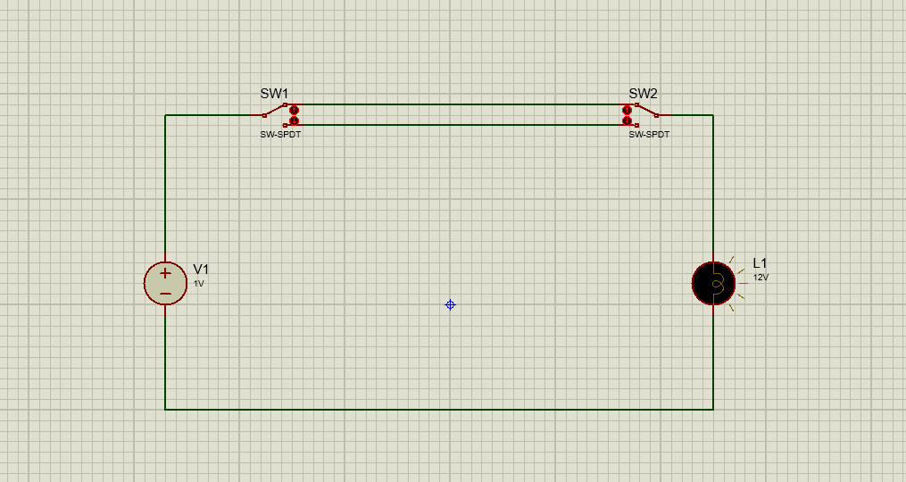
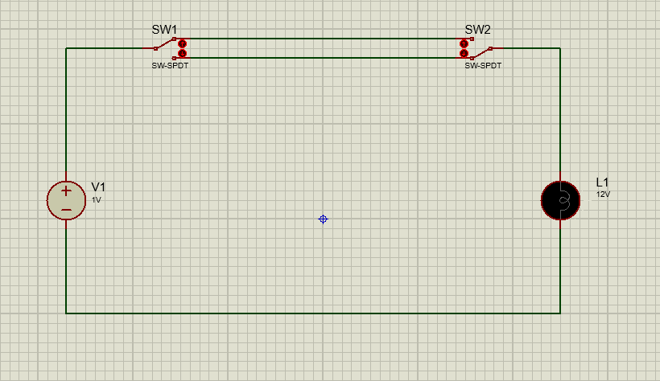
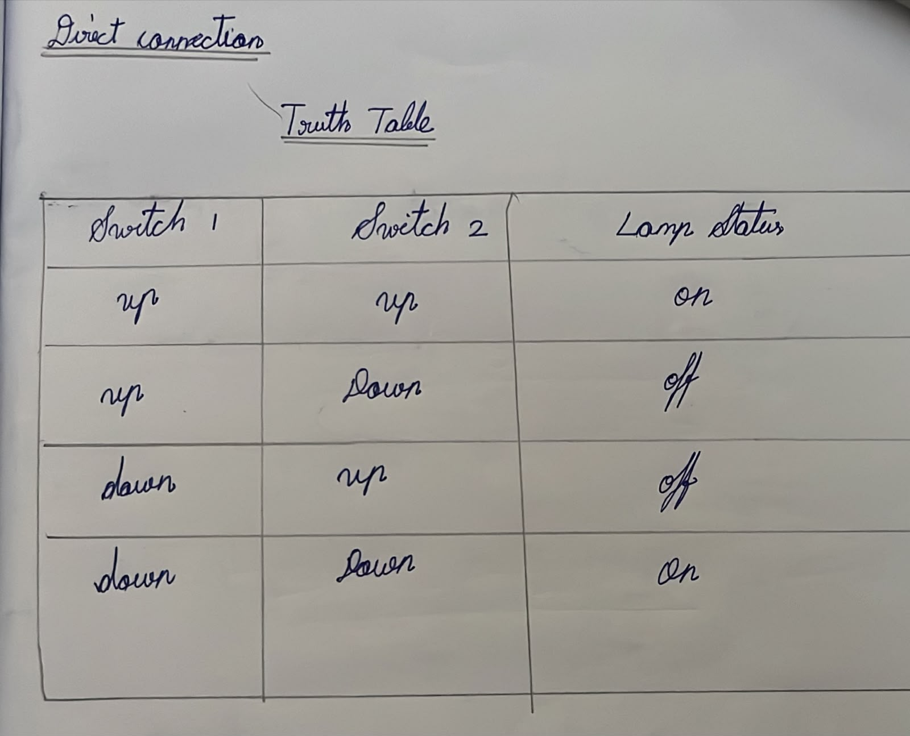
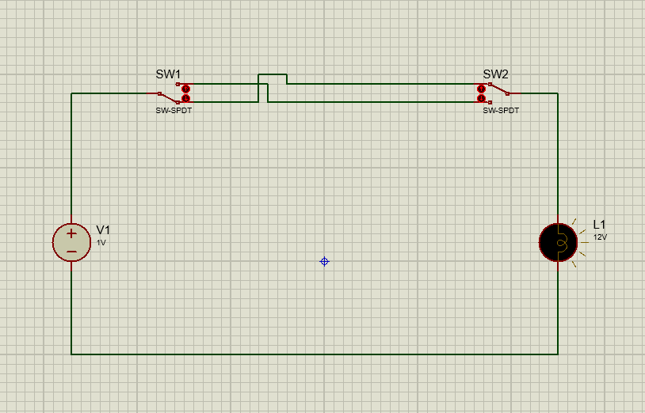
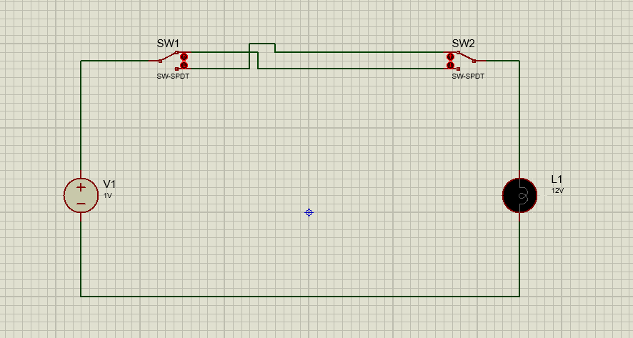
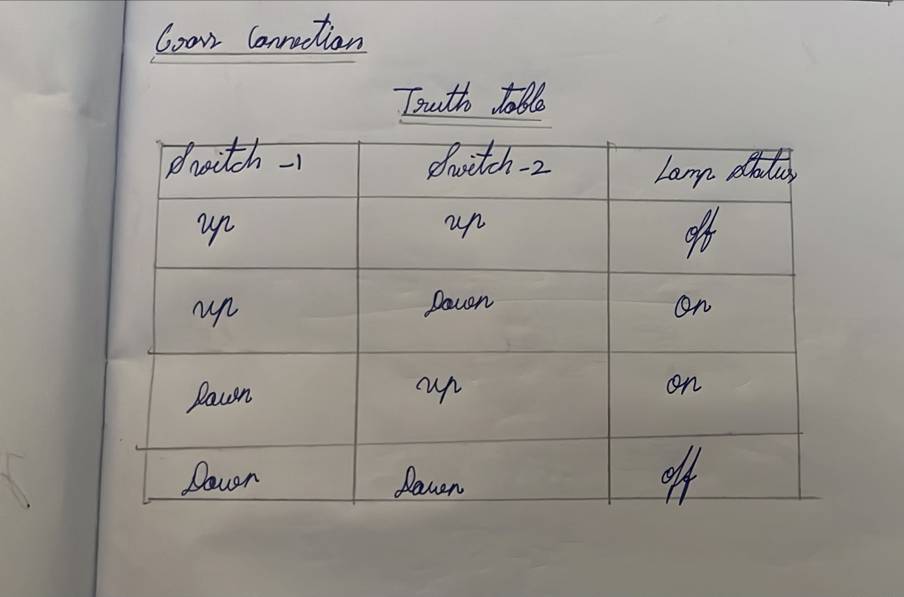

## EXPERIMENT NO. 3 – STAIRCASE WIRING

## AIM

To control the status of the given lamp by using two-way switches.

## APPARATUS REQUIRED

| S. No. | Name of the apparatus | Range / Type | Quantity |
|:---:|:---:|:---:|:---:|
| 1 | Incandescent lamp | 60 W | 1 No. |
| 2 | Lamp holder | Pendant type | 1 No. |
| 3 | SPDT switch | 230 V, 5 A | 2 Nos. |
| 4 | Wires | 1/18" | As required |
| 5 | PVC pipe | 1/4" | As required |
| 6 | Wooden board | — | 1 No. |
| 7 | Round block | — | 1 No. |
| 8 | Simulation software | Proteus Design Suite | 1 |

## THEORY

- A two-way switch is installed near the first step of the stairs. The other two-way switch is installed at the upper part where the stairs end.
- The light point is provided between the first and last stair at an adequate location and height. If the light is switched on by the lower switch, it can be switched off by the switch at the top, or vice versa.
- The circuit can also be used in places like a bedroom, where the person need not walk back to the place from where the light was switched on in order to switch it off.
- Two numbers of two-way switches are used for this purpose. The supply is given to the switch at the short-circuited (common) terminal.
- The connection to the light point is taken from the similar short-circuited (common) terminal of the second switch. The other two independent terminals of each switch are connected through cables.

## PROCEDURE

1. Place the accessories on the wiring board as per the circuit diagram.
2. Place the PVC pipe and insert two wires into the PVC pipe.
3. Take one wire; connect one end to the phase side and the other end to the middle (common) point of SPDT switch 1.
4. The upper point of SPDT switch 1 is connected to the lower point of SPDT switch 2.
5. The lower point of SPDT switch 1 is connected to the upper point of SPDT switch 2.
6. Another wire is taken through the PVC pipe, and the middle (common) point of SPDT switch 2 is connected to one end of the lamp holder.
7. The other end of the lamp holder is connected to the neutral line.
8. Screw the accessories on the board and switch on the supply.
9. Test the circuit for all possible combinations of switch positions.

## A. DIRECT CONNECTION

### Circuit diagram

### Tabulation 1: Truth table – direct connection

## B. CROSS CONNECTION

### Circuit diagram

### Tabulation 2: Truth table – cross connection

## RESULT

Thus, the staircase wiring was connected and tested for both direct and cross connections, and the lamp was controlled from two different places using two-way switches.
